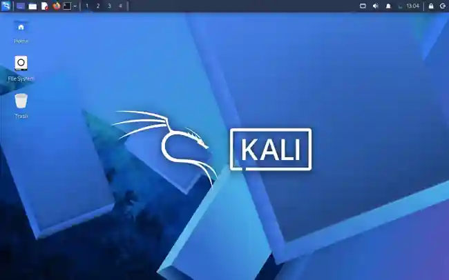
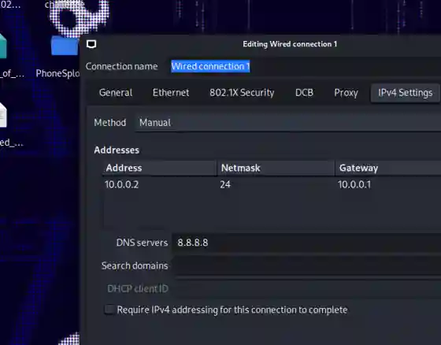

<div align="center">

# 🔐 Cybersecurity Lab Environment Setup

**Building an isolated Kali Linux virtual lab for ethical hacking and penetration-testing practice**

</div>

<p align="center">
  
  
  
  
  
  
  
</p>

---

## 📌 Project Overview

This project documents the setup of a virtual cybersecurity laboratory using Oracle VirtualBox and Kali Linux.

The objective is to prepare a controlled environment for learning Linux administration, virtual networking and authorized penetration-testing practice. The Kali virtual machine is connected to a VirtualBox NAT Network, and its IPv4 settings have been configured for the lab network.

This repository records the configuration evidenced by the screenshots, the verification steps to be performed, and issues encountered during setup. Additional target virtual machines and security exercises can be added in later stages.

---

## 🎯 Objectives

- Prepare a Kali Linux virtual machine in Oracle VirtualBox.
- Create and configure a dedicated NAT Network.
- Understand IPv4 addressing, gateway and DNS settings.
- Configure Kali Linux with a static IPv4 address.
- Inspect network interfaces and routing information.
- Test gateway, internet and DNS connectivity.
- Verify the availability of introductory security tools.
- Maintain a recovery snapshot before future experiments.
- Document the setup with screenshots and troubleshooting notes.

---

## 🛡️ Purpose of the Lab

The lab is intended for cybersecurity education and authorized testing in a controlled environment.

It can support future exercises such as:

- Network reconnaissance and host discovery
- Port scanning
- Packet capture and traffic analysis
- Vulnerability assessment
- Web application security testing
- Linux security experimentation

⚠️ **Ethical-use notice:** Only test systems that you own, isolated lab machines, or systems for which you have explicit written permission. Do not scan or access unrelated networks.

---

## 🏗️ Lab Architecture

The current setup consists of a Windows host, Oracle VirtualBox, a NAT Network and a Kali Linux virtual machine. A separate target VM is a future extension and is not shown as deployed in the current screenshots.

```text
                 WINDOWS HOST
                      |
               ORACLE VIRTUALBOX
                      |
           VirtualBox NAT Network
           Name: NatNetwork
           Network: 10.0.0.0/24
           DHCP: Enabled
                      |
                 KALI LINUX
              Static IPv4 configured
                 10.0.0.2/24
                      |
           Future authorized target VM
                 (planned)
```

Additional target machines may be attached to the same NAT Network for future authorized lab exercises.

---

## ⚙️ Lab Configuration

### VirtualBox NAT Network

| Component | Observed configuration |
|---|---|
| Network name | `NatNetwork` |
| Network mode | NAT Network |
| IPv4 prefix | `10.0.0.0/24` |
| DHCP server | Enabled |
| IPv6 | Disabled in the displayed settings |

### Kali Linux IPv4 Settings

| Parameter | Observed configuration |
|---|---|
| Connection name | Wired connection 1 |
| IPv4 method | Manual |
| IP address | `10.0.0.2` |
| Prefix / netmask | `/24` |
| Default gateway | `10.0.0.1` |
| DNS server | `8.8.8.8` |

The VirtualBox network and Kali IPv4 values above are taken from the supplied screenshots. The host hardware specifications, VirtualBox version and Kali release have not been independently established from those screenshots and are therefore not stated here.

---

# 🪜 Lab Setup Procedure

## Step 1. Prepare the Virtualization Environment

Oracle VirtualBox is used to host the Kali Linux virtual machine. The VirtualBox network manager is used to create and manage the lab network.

**Evidence:** VirtualBox Network Manager screenshot is provided in the next step. Add a VirtualBox Manager screenshot here if you have one showing the Kali VM entry and its state.

---

## Step 2. Create the NAT Network

A NAT Network named `NatNetwork` is configured in VirtualBox.

**Configuration shown in the screenshot:**

```text
Name:       NatNetwork
IPv4 Prefix: 10.0.0.0/24
DHCP:       Enabled
IPv6:       Disabled
```

The NAT Network provides a shared virtual network for VMs connected to it. DHCP is enabled at the VirtualBox network level; the Kali connection screenshot separately shows a manually configured IPv4 profile.


*Figure 1 – VirtualBox NAT Network settings showing NatNetwork, 10.0.0.0/24 and DHCP enabled.*

---

## Step 3. Start Kali Linux

Kali Linux is started as a virtual machine in the lab environment. The supplied screenshot shows the Kali desktop loaded successfully.



*Figure 2 – Kali Linux desktop running in the virtual environment.*

---

## Step 4. Configure the Kali Linux IPv4 Connection

The wired connection is configured using the Manual IPv4 method.

**Settings shown in the screenshot:**

```text
Connection: Wired connection 1
Method:     Manual
Address:    10.0.0.2
Netmask:    24
Gateway:    10.0.0.1
DNS:        8.8.8.8
```



*Figure 3 – NetworkManager IPv4 settings for the Kali wired connection.*

> **Configuration note:** The displayed screenshot shows the settings in the connection editor. Use `ip a` and `ip route` after applying the profile to confirm the active address and route.

---

## Step 5. Verify Network Configuration

After applying the network profile, inspect the active interface and routing table.

```bash
ip a
ip route
nmcli device status
nmcli connection show
```

Expected checks:

- The active wired interface should show the configured IPv4 address.
- The routing table should show the configured default gateway.
- NetworkManager should report the wired interface state.

**Evidence to add:** Capture your terminal output after running these commands and save it as `screenshots/04-ip-and-route-verification.png`.

---

## Step 6. Test Connectivity and DNS

Run the following tests from Kali Linux:

```bash
ping -c 4 10.0.0.1
ping -c 4 8.8.8.8
nslookup example.com
```

These checks test gateway reachability, outbound IP connectivity and DNS resolution respectively.

| Test | Command | What to record |
|---|---|---|
| Gateway | `ping -c 4 10.0.0.1` | Replies or packet loss |
| Internet by IP | `ping -c 4 8.8.8.8` | Replies or packet loss |
| DNS | `nslookup example.com` | Resolved address or error |

**Status:** Results have not yet been supplied. Add the terminal screenshot and update this section after running the tests.

---

## Step 7. Verify Security Tools

Check whether Nmap is installed and record the version:

```bash
nmap --version
```

If Nmap is not installed, install it using the official Kali package repositories before recording the result.

**Evidence to add:** Save the actual terminal output as `screenshots/06-nmap-verification.png`.

---

## Step 8. Create a Clean Virtual Machine Snapshot

Once the base operating system and network configuration have been verified, create a VirtualBox snapshot so the lab can be restored to a known baseline.

Suggested name:

```text
Kali-Linux-Clean-Baseline
```

**Status:** Snapshot evidence has not been supplied yet. Add a screenshot of the VirtualBox Snapshots view after creating it as `screenshots/07-vm-snapshot.png`.

---

# 🔎 Lab Verification

Use this table to record the actual results. Do not mark a test successful until you have run it.

| Test | Command / evidence | Status |
|---|---|---|
| NAT Network exists | VirtualBox Network Manager screenshot | Shown |
| NAT Network prefix | `10.0.0.0/24` | Shown |
| DHCP enabled | VirtualBox Network Manager screenshot | Shown |
| Kali desktop loads | Kali desktop screenshot | Shown |
| Manual IPv4 profile | NetworkManager screenshot | Shown |
| Active IP address | `ip a` | Pending terminal evidence |
| Default route | `ip route` | Pending terminal evidence |
| Gateway connectivity | `ping -c 4 10.0.0.1` | Pending |
| Internet connectivity | `ping -c 4 8.8.8.8` | Pending |
| DNS resolution | `nslookup example.com` | Pending |
| Nmap availability | `nmap --version` | Pending |
| Recovery snapshot | VirtualBox Snapshots view | Pending |

---

# 🐞 Problems Encountered & Troubleshooting

Record issues that actually occurred in your setup. The following checks are useful when diagnosing common problems; they are not claims that each issue occurred.

## 1. Kali Has No Network Connectivity

Inspect the interface, connection and route:

```bash
ip a
ip route
nmcli device status
nmcli connection show
```

Then verify that the VM network adapter is attached to the correct VirtualBox NAT Network and that the configured gateway matches the lab network.

## 2. Static IPv4 Settings Do Not Become Active

Check the active NetworkManager connection and inspect its IPv4 configuration:

```bash
nmcli connection show
nmcli device status
```

Confirm the connection name before modifying or restarting it. Interface and connection names can differ between installations.

## 3. DNS Resolution Fails

Compare IP connectivity with DNS resolution:

```bash
ping -c 4 8.8.8.8
nslookup example.com
```

If the IP test works but name resolution fails, inspect the DNS settings in the active connection profile.

---

# 💡 What I Learned

### 1. Virtual Networking

Learned how a VirtualBox NAT Network can provide a shared network for multiple virtual machines.

### 2. IPv4 Configuration

Practised identifying an IPv4 address, prefix, gateway and DNS server in NetworkManager.

### 3. Kali Linux Environment

Gained practical exposure to the Kali Linux desktop and its network configuration interface.

### 4. Network Troubleshooting

Identified the commands needed to inspect interfaces, routes, connectivity and DNS.

### 5. Lab Documentation

Learned to maintain configuration evidence and distinguish completed checks from tests that are still pending.

---

# 🔐 Security & Ethical Use

This lab is for education and authorized security testing only.

- Use systems you own or have permission to test.
- Keep practical exercises within the intended lab scope.
- Avoid publishing sensitive credentials or personal data.
- Preserve a clean VM baseline before experimental changes.

---

# 🔗 Tools & Resources

- **Kali Linux:** [https://www.kali.org/get-kali/](https://www.kali.org/get-kali/)
- **Oracle VirtualBox:** [https://www.virtualbox.org/wiki/Downloads](https://www.virtualbox.org/wiki/Downloads)
- **Nmap:** [https://nmap.org/](https://nmap.org/)
- **Wireshark:** [https://www.wireshark.org/](https://www.wireshark.org/)

---

# 👨‍💻 Author

**Irfan RS**  
Cybersecurity Learner | Linux | Networking | Ethical Hacking

GitHub: [Irfanrastam](https://github.com/Irfanrastam)

---

## 📌 Project Information

**Program:** NetworkWalks Cybersecurity Program  
**Week:** 01  
**Project:** Cybersecurity Lab Environment Setup  
**Category:** Cybersecurity / Linux / Networking / Virtualization  
**Repository:** GitHub

<div align="center">

**LEARN • CONFIGURE • VERIFY • SECURE**

*Building practical cybersecurity skills through a controlled virtual lab.*

</div>
