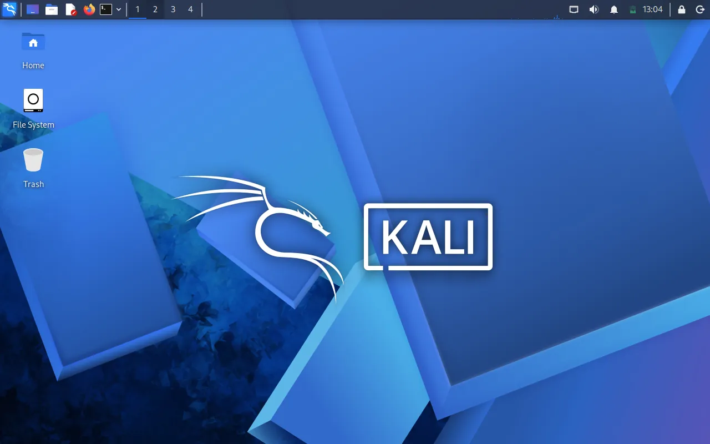
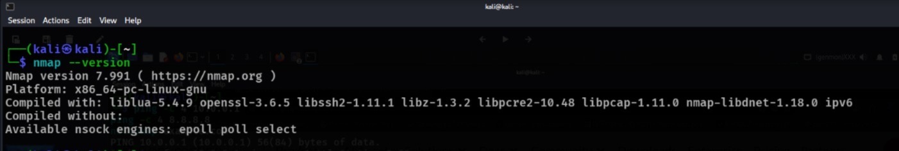
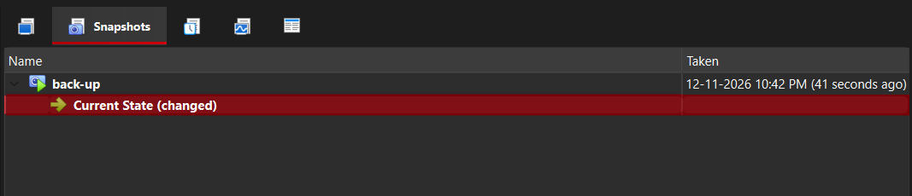

<div align="center">

# 🔐 Cybersecurity Lab Environment Setup

**Building an isolated Kali Linux virtual lab for ethical hacking and penetration-testing practice**

</div>

<p align="center">
  
  
  
  
  
  
  
</p>

---

## 📌 Project Overview

This project documents the deployment and configuration of a virtual cybersecurity laboratory using Oracle VirtualBox and Kali Linux.

The lab uses a VirtualBox **NAT Network** named `NatNetwork`, with the IPv4 prefix `10.0.0.0/24`. Kali Linux is configured with a manual IPv4 profile so that its address, gateway and DNS settings can be documented consistently.

The purpose of this environment is to build practical foundations in Linux administration, virtualization, network configuration and authorized penetration-testing. The repository includes the screenshots collected during setup, connectivity checks, Nmap verification and the virtual-machine snapshot.

The laboratory can be extended later by adding a separate target VM for controlled security exercises.

---

## 🎯 Project Objectives

The main objectives of this project are to:

- Prepare Kali Linux as a virtual machine in Oracle VirtualBox.
- Create a dedicated NAT Network for the lab.
- Configure and understand IPv4 addressing.
- Set the Kali Linux address, default gateway and DNS server.
- Inspect network interfaces and routing information.
- Test connectivity to the lab gateway and an external IP address.
- Check DNS configuration and resolution.
- Verify the Nmap installation.
- Create a VirtualBox snapshot as a recovery point.
- Record screenshots, configuration details and troubleshooting steps.

---

## 🛡️ Purpose of the Lab

This laboratory provides a controlled environment for cybersecurity learning and authorized security testing.

It can be used for future practical activities such as:

- Network reconnaissance and host discovery
- Port scanning
- Packet capture and traffic analysis
- Vulnerability assessment
- Web application security testing
- Linux security experimentation

⚠️ **Ethical-use notice:** Only test systems that you own, isolated lab machines, or systems for which you have explicit permission. Do not scan or access unrelated networks.

---

## 🏗️ Lab Architecture

The current setup contains a Windows host, Oracle VirtualBox, a NAT Network and a Kali Linux virtual machine. A separate target VM is a planned future addition; it is not represented as an already deployed machine.

```text
                  WINDOWS HOST
                       |
                ORACLE VIRTUALBOX
                       |
             VIRTUALBOX NAT NETWORK
                Name: NatNetwork
             Network: 10.0.0.0/24
                DHCP: Enabled
                       |
                  KALI LINUX
               Manual IPv4 Profile
                 10.0.0.2/24
                       |
             FUTURE TARGET VM
                  (planned)
```

Additional virtual machines can be attached to the NAT Network for future authorized testing.

---

## ⚙️ Lab Configuration

### VirtualBox NAT Network

| Component | Configuration |
|---|---|
| Network name | `NatNetwork` |
| Network mode | NAT Network |
| IPv4 prefix | `10.0.0.0/24` |
| DHCP server | Enabled |
| IPv6 | Disabled in the displayed network settings |

### Kali Linux IPv4 Configuration

| Parameter | Configuration |
|---|---|
| Connection name | `Wired connection 1` |
| IPv4 method | Manual |
| IP address | `10.0.0.2` |
| Prefix / netmask | `/24` |
| Default gateway | `10.0.0.1` |
| DNS server | `8.8.8.8` |

The NAT Network settings and manual IPv4 values above are taken from the supplied screenshots. The configured address and profile should also be checked from the running Kali terminal using `ip a` and `ip route`.

---

# 🪜 Lab Setup Procedure

## Step 1. Prepare the Virtualization Environment

Oracle VirtualBox is used to run Kali Linux as a virtual machine. The network manager in VirtualBox is used to create and manage the NAT Network for the lab.

The following screenshots document the virtual-network and Kali environment prepared for this project.

---

## Step 2. Create the NAT Network

A dedicated NAT Network named `NatNetwork` was configured in VirtualBox.

**Configuration:**

```text
Network Name: NatNetwork
IPv4 Prefix:  10.0.0.0/24
DHCP:         Enabled
IPv6:         Disabled
```


*Figure 1 – VirtualBox NAT Network Manager showing NatNetwork, the IPv4 prefix 10.0.0.0/24 and DHCP enabled.*

A NAT Network allows virtual machines connected to the same network to communicate with each other while providing outbound network connectivity.

---

## Step 3. Start Kali Linux

Kali Linux was started in the virtual environment. The desktop screenshot confirms that the operating system has booted to its graphical desktop.



*Figure 2 – Kali Linux desktop running in the virtual machine.*

---

## Step 4. Configure the Wired Network Connection

The Kali Linux wired connection was inspected using the NetworkManager connection editor.

The connection profile is named `Wired connection 1`. The following screenshot is included as supporting evidence for the wired connection configuration.


*Figure 3 – Kali Linux wired connection configuration.*

---

## Step 5. Configure Manual IPv4 Settings

The IPv4 method was set to **Manual** and the lab network values were entered in the connection profile.

**Configured values:**

```text
Connection: Wired connection 1
Method:     Manual
Address:    10.0.0.2
Netmask:    24
Gateway:    10.0.0.1
DNS:        8.8.8.8
```


*Figure 4 – NetworkManager IPv4 settings showing the manual address, gateway and DNS configuration.*

After applying the settings, the active interface and route can be checked from the terminal:

```bash
ip a
ip route
nmcli device status
```

---

## Step 6. Test Network Connectivity and DNS

Connectivity was checked from the Kali Linux terminal using ping commands for the NAT Network gateway and an external IP address. The supplied terminal evidence shows successful replies from both addresses.

**Commands used:**

```bash
ping -c 4 10.0.0.1
ping -c 4 8.8.8.8
nslookup example.com
```

The captured ping output shows:

- Gateway `10.0.0.1`: 4 packets transmitted, 4 received, 0% packet loss.
- External IP `8.8.8.8`: 4 packets transmitted, 4 received, 0% packet loss.
- DNS lookup: the screenshot shows the configured resolver `8.8.8.8`; the returned answer for `example.com` is not fully visible in the supplied capture.


*Figure 5 – Terminal connectivity checks for the NAT gateway and external IP, followed by a DNS lookup command.*

**Note:** The ping tests confirm IP connectivity in the captured session. To document DNS resolution conclusively, capture the complete `nslookup example.com` output including the returned address.

---

## Step 7. Verify Nmap Installation

Nmap is a network exploration and security auditing tool commonly used in authorized lab exercises.

The installed version was checked using:

```bash
nmap --version
```



*Figure 6 – Nmap version verification from the Kali Linux environment.*

The version screenshot is included as evidence that the Nmap version command was executed. Use the displayed version in the screenshot if you need to record the exact release number.

---

## Step 8. Create a Virtual Machine Snapshot

A VirtualBox snapshot provides a recovery point for the Kali Linux virtual machine before future experiments or configuration changes.

The supplied screenshot documents the snapshot view.



*Figure 7 – VirtualBox snapshot evidence for the Kali Linux virtual machine.*

A clean baseline snapshot should be retained before performing future security experiments. Restoring the snapshot should be tested separately before claiming recovery has been verified.

---

# 🔎 Lab Verification

The following table summarizes the evidence currently included in this repository.

| Test / Configuration | Command or evidence | Result |
|---|---|---|
| NAT Network created | VirtualBox NAT Network screenshot | Shown |
| IPv4 prefix | `10.0.0.0/24` | Shown |
| DHCP enabled | VirtualBox NAT Network screenshot | Shown |
| Kali Linux desktop | Desktop screenshot | Shown |
| Wired connection profile | Wired connection screenshot | Shown |
| Manual IPv4 profile | NetworkManager IPv4 screenshot | Shown |
| Gateway connectivity | `ping -c 4 10.0.0.1` | 4 received, 0% loss |
| External IP connectivity | `ping -c 4 8.8.8.8` | 4 received, 0% loss |
| DNS lookup | `nslookup example.com` | Resolver shown; answer not fully visible |
| Nmap version | `nmap --version` | Screenshot supplied |
| VM snapshot | VirtualBox snapshot screenshot | Screenshot supplied |

### Additional terminal checks

Use these commands to confirm the active Kali interface and DNS result:

```bash
ip a
ip route
nmcli device status
nslookup example.com
```

---

# 🐞 Problems Encountered & Troubleshooting

During virtual-network setup, connectivity and IP configuration need to be checked together. The following troubleshooting steps are useful for diagnosing common lab issues.

## Problem 1. Kali Linux Uses an Unexpected IP Address

**Possible cause:** The VM may be connected to the default VirtualBox NAT adapter instead of the intended NAT Network, or the active connection may still be using DHCP.

**Checks:**

```bash
ip a
ip route
nmcli connection show
```

**Resolution approach:**

1. Confirm that the VM adapter is attached to `NatNetwork`.
2. Inspect the active NetworkManager connection.
3. Confirm the manual IPv4 settings.
4. Reapply the connection profile if required.
5. Verify the address and route again.

## Problem 2. Gateway Connectivity Fails

**Possible cause:** Incorrect adapter attachment, gateway value or network prefix.

**Checks:**

```bash
ip route
ping -c 4 10.0.0.1
```

**Resolution approach:**

- Verify the VirtualBox NAT Network settings.
- Confirm that the Kali VM is attached to the same NAT Network.
- Check that the configured gateway matches the lab network.
- Retest after applying the correct connection settings.

## Problem 3. DNS Resolution Does Not Complete

**Checks:**

```bash
ping -c 4 8.8.8.8
nslookup example.com
```

If IP connectivity works but name resolution does not, inspect the DNS server configured in the active NetworkManager profile.

---

# 💡 What I Learned

### 1. Virtual Network Configuration

Learned how to create a VirtualBox NAT Network and configure its IPv4 prefix and DHCP setting.

### 2. Kali Linux Networking

Practised configuring a wired connection using the manual IPv4 method.

### 3. IP Addressing and Routing

Worked with an IPv4 address, subnet prefix, default gateway and DNS server.

### 4. Connectivity Testing

Used ping to test communication with the lab gateway and an external IP address.

### 5. Security Tool Familiarization

Checked the Nmap installation and recorded its version information.

### 6. Virtual Machine Recovery

Documented the VirtualBox snapshot as a recovery point for future lab exercises.

### 7. Technical Documentation

Organized screenshots, commands, configuration values and verification results into a repeatable project record.

---

# 🔐 Security & Ethical Use

This laboratory is intended strictly for educational purposes and authorized cybersecurity research.

- Perform testing only on systems you own or have permission to assess.
- Keep security exercises within the intended lab scope.
- Do not publish passwords, tokens or other sensitive information.
- Maintain a clean recovery point before experimental changes.
- Document test results accurately.

---

# 🔗 Tools & Resources

- **Kali Linux:** [https://www.kali.org/get-kali/](https://www.kali.org/get-kali/)
- **Oracle VirtualBox:** [https://www.virtualbox.org/wiki/Downloads](https://www.virtualbox.org/wiki/Downloads)
- **Nmap:** [https://nmap.org/](https://nmap.org/)
- **Wireshark:** [https://www.wireshark.org/](https://www.wireshark.org/)

---

# 👨‍💻 Author

**Irfan RS**  
Cybersecurity Learner | Linux | Networking | Ethical Hacking

GitHub: [Irfanrastam](https://github.com/Irfanrastam)

---

## 📌 Project Information

**Program:** NetworkWalks Cybersecurity Program  
**Week:** 01  
**Project:** Cybersecurity Lab Environment Setup  
**Category:** Cybersecurity / Linux / Networking / Virtualization  
**Repository:** GitHub

<div align="center">

**LEARN • CONFIGURE • TEST • SECURE**

*Building practical cybersecurity skills through a controlled virtual lab.*

</div>
